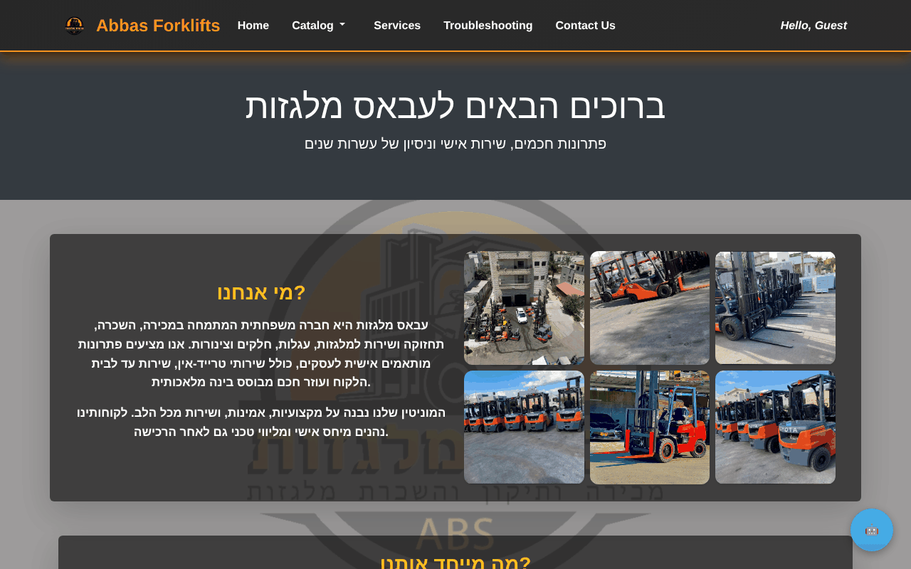
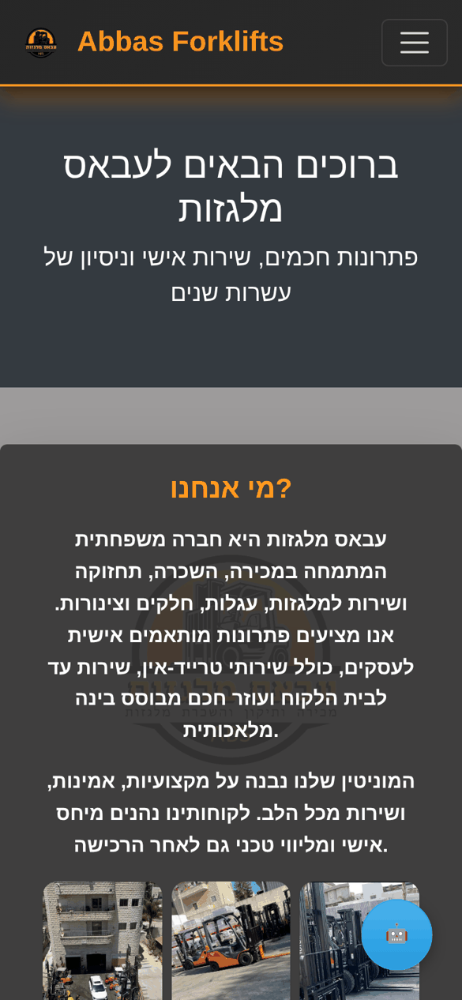
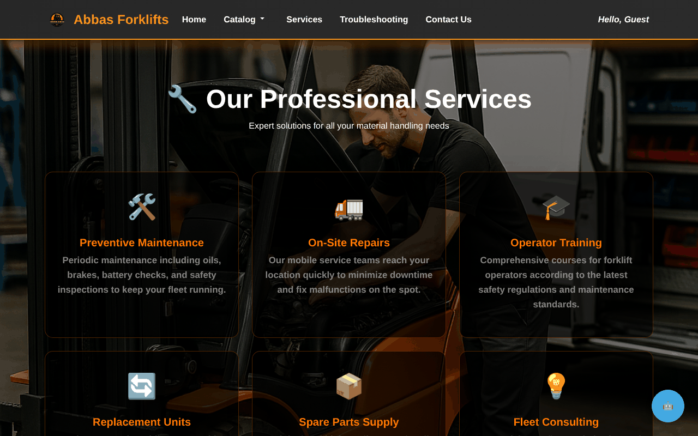
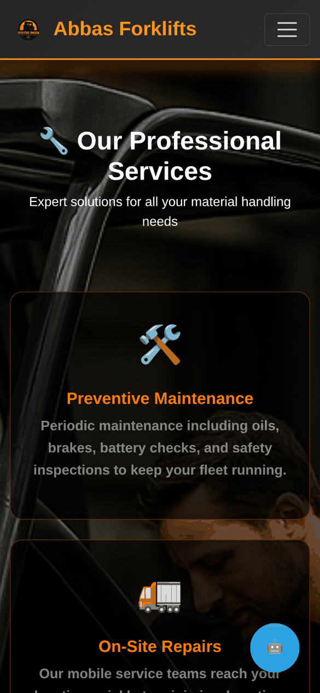
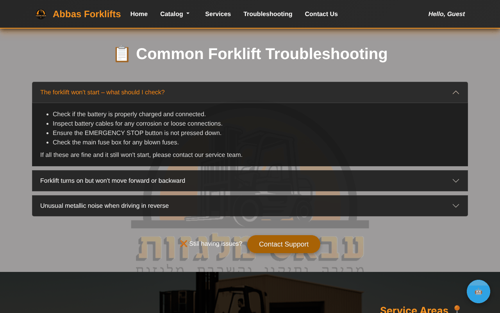
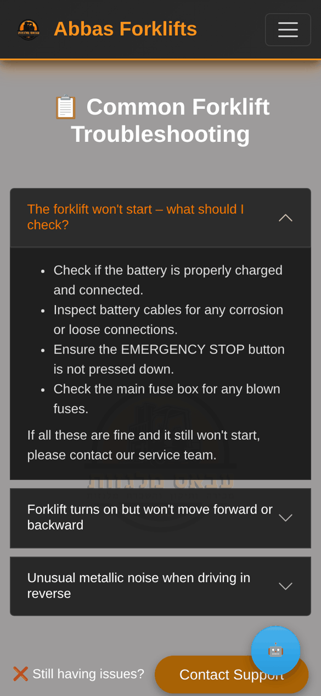

# Forklift Service Platform

Full-stack web platform for a forklift sales & service company — product catalog, customer portal, technician workspace, back office and an AI support chatbot.
Final project, B.A. Information Systems, University of Haifa.

## Screenshots

| Desktop | Mobile |
|---|---|
| **About**<br> |  |
| **Services**<br> |  |
| **Troubleshooting guide**<br> |  |

## Features
- **Public site** – catalogs for forklifts, spare parts, hoses, pallets and accessories; product details; services, troubleshooting guide, contact form.
- **Auth & roles** – sign-up / login with hashed passwords; roles: client, technician, admin.
- **Client area** – open service tickets, track their status, view invoices.
- **Technician area** – assigned tickets, status updates, work notes.
- **Back office (admin)** – manage products, users, tickets and invoices.
- **AI chatbot** – Python FastAPI service using Google Gemini (function calling) that answers from a knowledge base and live DB data (products, tickets), aware of the user's role. Requests from PHP are signed with HMAC-SHA256.

## Tech stack
PHP 8 (PDO) · MySQL · Bootstrap 5 · JavaScript · Python (FastAPI, google-genai, PyMySQL) · Composer

## Project structure
```
├── index.php, catalog_*.php, details.php, services.php, contact.php
├── client_area.php, tech_area.php, backoffice.php
├── loginLogic.php, signupLogic.php, logout.php
├── chatbot.php / chatbot.js     # PHP proxy + chat widget
├── inc/                         # header, navbar, footer
├── config/config.example.php    # copy to config.php
└── ai-server/                   # FastAPI + Gemini service
    ├── main.py, KB.json, conversation_policy.json, db_schema_knowledge.json
    └── .env.example             # copy to .env
```

## Running locally
1. Import the MySQL database (`forklift_fixed`) and set credentials in `db.php`.
2. `cp config/config.example.php config/config.php` and fill in your keys.
3. `composer install`
4. AI server:
   ```bash
   cd ai-server
   cp .env.example .env        # fill in the same AI_SHARED_SECRET as in config.php
   pip install -r requirements.txt
   uvicorn main:app --port 8000
   ```
5. Serve the PHP folder (XAMPP / `php -S localhost:8080`).

## Authors
- Nour Eldin Khatib
- Samar Amon
- Nasser Habrat
